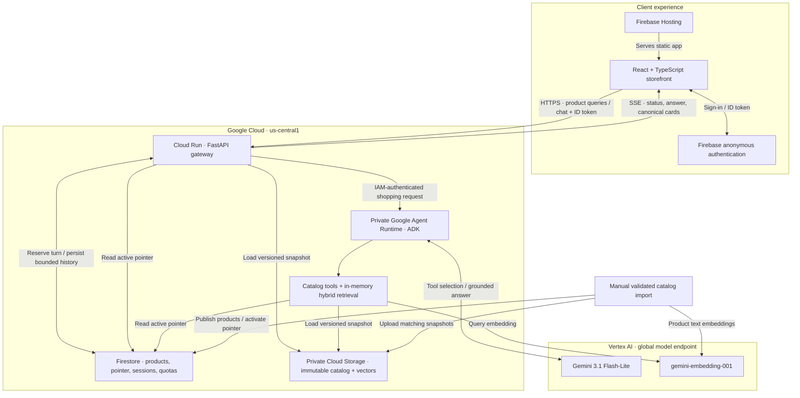
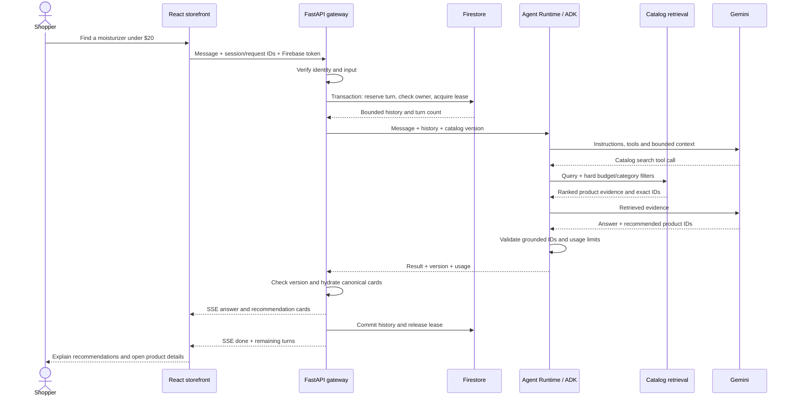

# Luma Beauty · AI shopping agent

Luma Beauty is an end-to-end AI commerce demo: a responsive storefront, an
updatable **100-product skincare catalog**, and a shopping agent that turns
natural-language needs into recommendations backed by product evidence.

The project connects a React interface to a Python API and a Google ADK agent
deployed on **Google Agent Runtime** using Google's
[`agents-cli`](https://github.com/google/agents-cli). It demonstrates how to build,
deploy, and operate a small RAG application with authentication, persistent
conversations, versioned data, and explicit usage controls.

**[Live demo](https://sitiosweb1-luma-beauty.web.app)** ·
[Architecture](docs/ARCHITECTURE.md) · [Setup](docs/LOCAL_SETUP.md) ·
[Deployment](docs/DEPLOYMENT.md) · [Costs](docs/COSTS.md)

**Observability upgrade:** a reviewed-release candidate adds Google-native traces,
performance metrics, dashboards, console incidents, security evaluations and
offline CI. The live site still runs the previous release. See
[hardening design and measured results](docs/HARDENING.md) and
[threat model](docs/THREAT_MODEL.md).

This is a fake store: no payments, purchases, fulfillment, or live inventory.
Prices and aggregate ratings are a **2023 historical snapshot**. Luma uses original
branding and is not affiliated with Amazon, Walmart, or the featured brands.

## Video demo

Watch Luma browse products, compare options, and recommend skincare through its AI
shopping assistant.

https://github.com/user-attachments/assets/4d26a288-8290-41fe-ada8-16a67919d0a3

## Project goal

Shopping assistants need to understand a shopper's preferences while working with
the products a store actually carries. This project explores that workflow with
an affordable cloud deployment and a catalog that can change independently of
the agent's code.

A shopper can ask for a moisturizer under $20, compare the recommended products,
or refine their preferences in a follow-up. The agent searches the catalog,
explains the available evidence and tradeoffs, and returns clickable product cards.
When the catalog has no match or lacks ingredient information, the assistant
acknowledges the gap rather than supplying an invented product or claim.

### Engineering work demonstrated

| Area | Implementation |
|---|---|
| Full-stack development | React/TypeScript storefront connected to a Python/FastAPI API |
| Agent engineering | ADK tool calling, multi-turn context, forced retrieval and response validation |
| RAG and data engineering | Validated product imports, text embeddings, hybrid retrieval and versioned updates |
| Cloud infrastructure | Agent Runtime, Cloud Run, Firebase, Firestore, Storage and Terraform |
| Access and state management | Anonymous identity, transaction-backed quotas, ownership and replay protection |
| Product experience | Accessible chat modal, animated AI avatar, mobile layout and simulated shopping flow |
| Validation and operations | Metadata-only OpenTelemetry, Google Trace/Logging/Monitoring, security evaluations, offline CI and reviewed Terraform releases |

## Features

- Marketplace navigation, search, category/budget filters, details and simulated cart.
- Centered AI chat with an animated Blobatar, thinking states, launcher transitions,
  keyboard focus handling, mobile layout and reduced-motion support.
- RAG using Gemini embeddings, in-memory similarity, keywords and hard filters.
- Grounded recommendation IDs; canonical product cards supplied by the API.
- Firebase anonymous authentication and transactional server quotas: 100
  conversations/month, 10 turns/session, 1,000 total attempted turns/month.
- Versioned catalog updates with atomic activation and 30-second cloud refresh.
  Updating products does not require redeploying the agent.
- Agent Runtime and Cloud Run scale to zero, with at most two instances each.
- Hardening candidate: transaction-backed visitor throttling, 30-day session expiry,
  server-owned trace context/support IDs and strict fail-closed runtime validation.
- Reused cloud clients and a bounded query embedding cache; seven local baseline
  turns fell from 138.16 to 30.64 seconds. Repeat warm p95: 13.39 seconds at
  concurrency one and 12.60 seconds at concurrency two (six warm samples each;
  hosted cold/warm performance still requires rollout validation).
- Forty-seven backend tests, two agent checks and nine browser tests pass. The
  20-scenario suite passes deterministic constraints; native offline grading of
  fourteen synthetic responses scores 4.79/5 for quality and 14/14 safe. These small
  evaluations do not establish production safety. Detailed reports stay private.

## Stack

| Layer | Technology | Role |
|---|---|---|
| Interface | React 19, TypeScript, Vite, Lucide | Store, filters, product details, cart and chat |
| Agent avatar | Blobatar / @blobatar/react 2.7.0 | Browser-rendered avatar and thinking/idle states |
| Static hosting | Firebase Hosting | Public storefront deployment |
| Visitor identity | Firebase Authentication | Anonymous sign-in and ID tokens |
| Public API | Python, FastAPI, Pydantic, HTTPX, SSE | Validation, authenticated chat and canonical cards |
| Gateway hosting | Google Cloud Run | Containerized, usage-based API hosting |
| Agent framework | Google ADK | Tools, model callbacks and bounded agent execution |
| Agent deployment | agents-cli 1.9.0, Google Agent Runtime | Scaffold, package and host the private agent |
| Generation | Gemini 3.1 Flash-Lite through Vertex AI | Clarification, comparisons and evidence-based answers |
| Embeddings | gemini-embedding-001, 768 dimensions | Semantic product/query representation |
| Database | Cloud Firestore | Product versions, active pointer, session histories and quotas |
| Snapshot storage | Google Cloud Storage | Private immutable product/embedding bundles |
| Infrastructure | Terraform, Cloud Build, Artifact Registry, Docker | Provision services and build/store containers |
| Data collection | Python, Beautiful Soup, Playwright | Dataset selection, imports and optional collectors |
| Testing | pytest, pytest-asyncio, Playwright, TypeScript compiler | Backend behavior and browser workflows |

## System architecture

The browser uses a public gateway, while the agent and catalog objects remain
private. The gateway controls authentication, session ownership and usage limits;
the agent controls retrieval and inference. Both read the same versioned catalog.



### A shopping conversation



### RAG and agent design

The catalog represents the agent's available product knowledge. Import embeds
English title, brand, category and description into 768-dimensional vectors.
At inference time, `search_products` embeds the query, applies price/category
constraints, and combines cosine similarity with keyword overlap. The implemented
score weights semantic relevance at 70% and lexical relevance at 30% when a query
vector is available. Public browsing can use keyword search without model calls.

| Tool/control | Purpose |
|---|---|
| `search_products` | Retrieve up to four ranked candidates with hard budget/category filters |
| `get_product` | Read canonical details for a known product ID |
| Required retrieval | Force a search when the turn has no current catalog evidence |
| Grounded ID validation | Accept recommendation IDs only from retrieved/current evidence |
| Canonical card hydration | Fill prices, images and links from catalog records outside the model |
| Context refresh | Rehydrate previously recommended products for follow-up comparisons |
| Bounded execution | Limit model/tool calls, input tokens, output and inference duration |

The agent recommends at most three products and returns a structured answer with
product IDs. Ratings are comparative evidence, not proof of suitability. It cannot
quote written reviews or infer absent ingredients. Product text, shopper messages
and history are treated as untrusted data. These guards reduce errors without
guaranteeing that every natural-language answer is correct.

### Updatable database and retrieval bundles

The active demo uses historical metadata from
[Amazon Beauty & Personal Care 2023](https://huggingface.co/datasets/smartcat/Amazon_Beauty_and_Personal_Care_2023).
Selection filters skincare records, deduplicates ASINs, requires descriptions and
positive USD prices, and checks image reachability. The deployed selection contains
100 complete records. Import and source snapshot timestamps are stored separately.

Each product includes ID, source/provenance URL, English/source title and description,
brand, category, features, image URLs, original price, nullable rating/review count,
collection timestamp and source freshness. US dataset prices retain their original
USD value; the optional Amazon Mexico importer uses a labeled simulated MXN ÷ 18
conversion. No written customer reviews are used.

| Storage location | Responsibility |
|---|---|
| `beauty_store_catalogs/{version}/products` | Versioned product documents in Firestore |
| `beauty_store_metadata/active_catalog` | Active fingerprint and matching GCS paths |
| `beauty_store_sessions` | Anonymous visitor ownership, bounded history, request IDs and leases |
| `beauty_store_quotas` | Monthly global conversation/message counters |
| `catalogs/{version}/` in Cloud Storage | Immutable product JSON and embedding bundle |

Updates follow **validate → embed changed text → upload both snapshots → atomically
activate the pointer**. Embedding cache entries are keyed by text/model settings.
Services poll the pointer every 30 seconds and the frontend refreshes its product
query on the same interval. A mismatched version fails instead of mixing evidence
and cards. Retaining earlier snapshots allows rollback without a code deployment.
Catalog refresh is manual; current retail prices are not fetched automatically.

### Deployment and access boundaries

- Firebase Hosting serves the static frontend; Firebase Auth supplies anonymous IDs.
- Cloud Run hosts the public gateway. Authenticated chat calls the private runtime
  using the gateway service account; browsers never receive cloud IAM credentials.
- Agent Runtime hosts the real ADK model/tool runner, deployed through `agents-cli`.
  The scaffold also retains ADK, A2A and reasoning-engine serving adapters.
- Firestore and Storage are accessed through backend IAM; browser Firestore access
  is denied. Terraform provisions dedicated identities, storage, registry and API
  resources. Cloud Build builds the gateway container.
- The gateway and runtime have minimum zero and maximum two instances. Gateway:
  1 vCPU/512 MiB. Agent: 1 vCPU/4 GiB. Scale-to-zero can introduce cold starts.

Website history is persisted in Firestore and supplied to ephemeral ADK sessions.
It therefore does not appear in the platform's managed Sessions screen. The agent
is deployed under Agent Platform **Deployments** in `us-central1`; Registry
registration is separate and has not been performed. See [live resources](docs/LIVE.md).

### API and spending controls

| Endpoint | Behavior |
|---|---|
| `GET /health` | Catalog count/version and agent configuration |
| `GET /api/products` | Keyword/category/budget search |
| `GET /api/products/{id}` | Canonical product details |
| `POST /api/chat` | Authenticated session turn with SSE response |

Chat streams `status`, `answer`, `recommendations`, `done`, or `error` events;
it does not stream individual model tokens. Firestore transactions reserve usage
before inference and protect ownership across gateway instances. Duplicate request
IDs and overlapping turns are rejected. Failed attempts count toward allowance.

| Control | Pilot setting |
|---|---|
| Monthly conversations / attempted messages | 100 / 1,000 |
| Turns per session | 10 |
| Model calls / tool calls per turn | 3 / 4 |
| Cumulative input budget per turn | 12,000 tokens |
| Output per model call | 600 tokens |
| Retained conversation history | Latest 12 messages, bounded again before inference |
| Inference timeout / session lease | 90 seconds / 120 seconds |
| Quota calendar | America/Mexico_City |

Dedicated logs record usage/latency and error classes without logging prompts or
authorization headers. Automatic ADK telemetry exporters and long-term Memory Bank
are disabled. Age-based session deletion is not yet implemented. Billing alerts
notify; application quotas provide chat usage control rather than a total cloud
spending cap.

### Design choices

| Decision | Reason and tradeoff |
|---|---|
| In-memory retrieval for 100 products | Keeps operations simple and avoids a separate vector service; a larger catalog would need a different retrieval architecture |
| Gateway separate from agent | Keeps browser auth, quotas and canonical UI data outside model control |
| Immutable snapshots + active pointer | Allows consistent data/index updates and rollback; refresh propagation can briefly reject a turn |
| Anonymous identity | Lets visitors try the demo without registration; histories still require ownership and retention policies |
| Scale-to-zero + bounded inference | Limits idle/variable spending; introduces possible cold-start delay |
| Historical dataset | Provides real product metadata for the demo; prices/ratings are not current and reuse rights remain separate |

## Run locally

Use Python 3.11–3.13, Node.js 22+, and PowerShell. From the repository root:

```powershell
python -m venv .venv
.\.venv\Scripts\python.exe -m pip install -r requirements.txt uv google-agents-cli==1.9.0
.\.venv\Scripts\python.exe -m playwright install chromium
Push-Location frontend
npm ci
npx playwright install chromium
Copy-Item .env.example .env.local
Pop-Location
New-Item -ItemType Directory -Force reports | Out-Null
.\.venv\Scripts\python.exe -m scripts.select_amazon_dataset
.\.venv\Scripts\python.exe -m scripts.import_catalog data/amazon-2023/selected.json --require-100
.\scripts\run-local.ps1
```

Open [localhost:5173](http://127.0.0.1:5173). Downloaded records and embeddings are
not committed; the selector rebuilds the historical selection from upstream.
Verify source rights for your use, or supply a permitted catalog. Source access and
image availability can change; shortfalls fail instead of using invented products.

Import without `--embed` runs without model charges. Browsing works, but actual chat
needs Google Cloud credentials and embeddings: see [local setup](docs/LOCAL_SETUP.md).

## Documentation

| Guide | Contents |
|---|---|
| [Architecture](docs/ARCHITECTURE.md) | Request flow, RAG, grounding and session boundaries |
| [Local setup](docs/LOCAL_SETUP.md) | Installation, credentials, variables and commands |
| [Catalog](docs/CATALOG.md) | Source fields, selection, imports, embeddings and rollback |
| [API](docs/API.md) | Products, chat authentication, SSE events and errors |
| [Deployment](docs/DEPLOYMENT.md) | Terraform, private Agent Runtime, gateway and Hosting |
| [Fork configuration](docs/FORKING.md) | Reference-project values to replace for your own deployment |
| [Operations](docs/OPERATIONS.md) | Health, logs, quotas, troubleshooting and retention |
| [Costs](docs/COSTS.md) | Assumptions, measured usage, allowances and alerts |
| [Live deployment](docs/LIVE.md) | Actual resources and agent console link |
| [Validation](docs/VALIDATION.md) | Completed tests and evaluation limitations |
| [Data sources](docs/DATA_SOURCES.md) | Provenance and collector limitations |
| [Security](SECURITY.md) | Credentials, access controls, privacy and reporting |
| [Contributing](CONTRIBUTING.md) | Development workflow and validation |
| [Third-party notices](THIRD_PARTY.md) | Scaffold, avatar, dependencies and data rights |

## Layout

```text
frontend/  React store, AI chat UI and browser tests
gateway/   Authentication, API, streaming and quota/session persistence
beauty/    Product schema, retrieval, catalog loader and immutable snapshots
agent/     agents-cli scaffold, ADK tools, guardrails and runtime adapters
scripts/   Collect, import, publish, evaluate, deploy and verify
infra/     Terraform for the store's infrastructure
data/      Blank import templates; downloaded catalogs remain ignored
tests/     Backend, catalog, quota and agent-control tests
docs/      Setup, architecture, deployment and operation guides
```

`agent/beauty/` is generated: run `python -m scripts.stage_agent` before isolated
agent installation/deployment. Generated Terraform under `agent/deployment/` is
scaffold material; `infra/` is what this demo uses. No workflow deploys automatically.

## Validation and costs

```powershell
.\.venv\Scripts\python.exe -m pytest tests -q
Push-Location frontend
npm run build
npm test
Pop-Location
```

Recorded October 9, 2026:

| Validation | Outcome |
|---|---|
| Backend | 27 tests passed: imports, versions, retrieval, auth, quotas, ownership and failure handling |
| Browser | 9 tests passed: cart, filters, chat, modal accessibility, mobile and motion |
| Frontend | TypeScript check and production build passed |
| Real model evaluation | Seven catalog turns passed: budget search, comparison, vague needs, cleanser search, no match, missing ingredients and invented-product resistance |
| Cloud integration | Hosted anonymous auth, grounded cards, cross-visitor isolation and denied direct Firestore/runtime access verified |
| Actual hosted chat | Three canonical recommendation cards returned in a recorded 9.33-second browser interaction |

The seven-turn model evaluation used 12,209 input and 681 output tokens. These
are small functional samples, not production-scale load tests or independent
quality certification. Full test scope and limits: [validation](docs/VALIDATION.md).

| Usage scenario | Monthly planning estimate, USD |
|---|---|
| Idle, little website traffic | $0–$1 |
| 100 conversations, 10 messages each | **$3–$6** total allowance |

The conservative model calculation assumes 5,000 input and 600 output tokens
per message across calls, at the prices recorded October 9, 2026: $0.25 per million
input tokens and $1.50 per million output tokens. That gives $2.15 in model charges
for 1,000 messages; the total allowance includes modest infrastructure overhead.
Free allowances are shared, estimates exclude existing project costs, and actual
traffic/latency can change the bill. The reference project has MXN 180 monthly
budget alerts at 50%, 80% and 100%; alerts notify rather than stop spending.
See [detailed assumptions and sources](docs/COSTS.md).

## Demo scope and future work

Implemented: deployed agent inference, catalog tools, real historical products,
multi-turn comparisons, versioned updates, simulated cart and authenticated usage
controls. Checkout does not process payments or create orders. The catalog is
manually refreshed; no current stock, live prices or written reviews are available.
Downloaded third-party records and embeddings are excluded from the public repo;
selection/import code and templates are included.

Possible extensions include a licensed current product feed, transcript retention
automation, independent recommendation evaluations, larger-catalog retrieval,
managed Sessions/Registry integration, and authenticated user accounts. These are
future work, not features of the deployed demo.

## License

Application source: [Apache-2.0](LICENSE). Third-party licenses remain applicable.
Product descriptions, images, trademarks and datasets are **not licensed by this
repository**; see [third-party notices](THIRD_PARTY.md).
