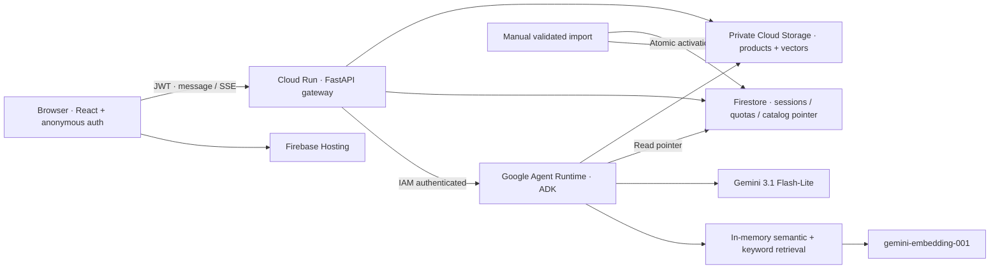

# Architecture

## Request flow

1. Firebase signs the visitor in anonymously; the gateway verifies the ID token.
2. A Firestore transaction reserves a turn, binds the session to its visitor,
   enforces limits and acquires a lease against concurrent messages.
3. The gateway sends message, bounded server history and catalog version to the
   private runtime with service-account credentials.
4. ADK calls `search_products` and optionally `get_product`. A turn without
   catalog evidence must search before answering. Data is untrusted evidence,
   not model instructions.
5. Agent controls bound model/tool/token usage and validate returned IDs against
   retrieved evidence. Gateway checks the version and hydrates canonical cards.
6. The gateway streams answer/card events, commits history and releases the lease.
   Failed attempts count toward quota.

SSE carries status and completed answers; it does not stream individual model
tokens. The cart is simulated in browser localStorage.

## Retrieval and updates

The importer embeds English title, brand, category and description at 768
dimensions. Query similarity and keyword relevance rank results; price/category
filters constrain candidates. One hundred records fit in process memory, avoiding
a separately hosted vector database. Ratings remain structured comparisons;
written reviews are absent. Missing ingredients stay unknown, and source claims
do not independently establish medical effectiveness or suitability.

Products and vectors are immutable snapshots identified by a fingerprint. Local
activation happens only after validation. Cloud publication uploads both objects,
then commits product documents and active pointer in a Firestore batch. Services
poll every 30 seconds and cache snapshots by version. A turn crossing a refresh
may fail the version guard; retry after propagation rather than mix evidence/cards.

## Session and console boundaries

Website history/ownership is stored in Firestore `beauty_store_sessions`. Its ADK
runner uses ephemeral sessions populated with bounded history. Website chats
therefore do not appear in Agent Platform's managed Sessions UI. The actual agent
is visible under Deployments in `us-central1`; see [live console link](LIVE.md).
Agent Registry registration is separate and not implemented.

The scaffold preserves ADK, A2A and reasoning-engine adapters. Generated managed
session utilities are distinct from the shopping route. Browser access goes
through the public gateway; runtime and storage stay IAM-protected.

## Limits

Both services have minimum zero, maximum two instances. Agent: 1 vCPU/4 GiB;
gateway: 1 vCPU/512 MiB. Monthly quotas use Mexico City time. One agent turn allows
three model calls, four tool calls, 12,000 cumulative input tokens and 600 output
tokens per call. These constrain chat spending; unrelated traffic/services can
still cost money. See [costs](COSTS.md) and [security](../SECURITY.md).
