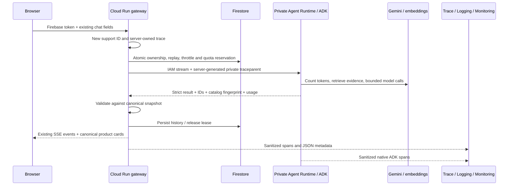

# Observability and hardening release

Status: deployed and verified October 13, 2026. This work strengthens a portfolio demo's engineering
controls; it does not provide enterprise certification or an availability SLA.

## Request and trace flow



`beauty/telemetry.py` installs one provider and one authenticated OTLP exporter.
ADK's native spans use that provider; the scaffold's exporter is disabled to
prevent duplicate capture. Exporter failures cannot interrupt shopping.
`gateway/tracing.py` discards incoming public trace parents and generates
`X-Request-ID`; the private runtime extracts only the gateway's propagated
trace parent. Errors include the same support ID without backend exception text.

The native proxy can replace the HTTP trace header. A strictly validated optional
private body field preserves the server-generated context across that boundary;
the public chat contract is unchanged. W3C trace flags include SDK-generated `03`.
An initial validator rejected that valid flag; traffic was restored to the working
gateway during repair, then resumed after the private compatibility probe passed.
The OTLP resource explicitly includes `gcp.project_id`; quota headers alone do not
select the export destination. Neither field is passed to the shopping prompt.

The gateway buffers at most 128 traces and 128 completed child spans per trace.
It exports all admitted chats and samples other HTTP requests at 10%; overflow
drops telemetry. Runtime spans export directly. A bounded batch exporter can lose
queued spans on abrupt shutdown or idle CPU throttling; do not assume delivery.

Operations cover authentication, quota reservation, catalog loading, credential
refresh, embeddings, retrieval, token counting, model/tool calls, validation,
history persistence and lease release. SSE failures are measured independently
of HTTP status. Expected quota/ownership rejections are not internal failures.

## Privacy and retention

Both `ADK_CAPTURE_MESSAGE_CONTENT_IN_SPANS=false` and
`OTEL_INSTRUMENTATION_GENAI_CAPTURE_MESSAGE_CONTENT=NO_CONTENT` are explicit.
The exporter additionally strips events, links, exception descriptions,
non-allowlisted attributes/resource fields and arbitrary span names. Exported
metadata includes timings, token counts, known tool names, model, outcome,
catalog fingerprint and revision. JSON support IDs are server-generated and
are never metric labels. Messages, tool arguments/results, visitor/session IDs,
credentials and authorization headers are excluded.

Conversation history remains private in Firestore. Session and throttle documents
use `expires_at` with 30-day inactivity TTL. Requests reject expired history before
Firestore deletes it. Legacy `updated_at` also enforces expiry; reviewed rollout
runs `scripts.backfill_session_expiry` to populate old TTL fields. Monthly counters
are not deleted. Google logs normally retain 30 days and Cloud Trace retains
30 days; this release does not change shared project log-bucket retention.
Synthetic evaluation reports in `reports/` and the private catalog bucket contain
conversational test data and are excluded from Git. Remove old evaluation exports
manually when no longer needed; no continuous evaluation is enabled.

## Dashboard and incident definitions

Terraform provisions `Luma agent · performance, reliability, security and cost`.
Application measurements are log-based metrics with bounded operation labels;
native Cloud Run and ReasoningEngine resource metrics are reused. Runtime charts
filter the existing Luma engine, not other agents in the project.

| Measurement | Definition |
|---|---|
| Completed / failed turns | `chat_completed` / `chat_failed` JSON events; cancellation is a failure |
| Internal failures | `chat_failed` with `outcome=internal`, excluding client cancellation and quota rejections |
| Completion p50/p95 | Wall time from gateway request entry through generated final SSE events; not browser receipt |
| First status | Time from gateway request entry to first generated SSE status; not browser receipt |
| Component latency | Operation durations; native ADK spans supply model/tool trace detail |
| Tokens / estimated cost | Observed input/output including reasoning; input × $0.25/M + output × $1.50/M |
| Quota consumption | Sampled high-water monthly reservation counters, not continuously polled gauges |
| Guards | Agent/gateway grounding failures; malformed streams also count as internal failures |
| Resource usage | Gateway CPU/memory and agent allocation/request metrics |

Incidents have no notification channels. Thresholds: failed five-minute health
windows sustained 15 minutes; at least three internal streamed failures/15 minutes;
completion p95 >30 seconds with at least 20 completed turns/hour; monthly counters
above 80 conversations or 800 turns. The latency incident includes cold starts;
warm-only classification comes from explicit benchmarks, not an invented metric.
Health incidents use Monitoring's sustained-window semantics and are not an exact
counter of three individual probes across geographic checkers.

## Performance evidence (2026-10-13)

The identical seven-case sequential local evaluation took 138.16 seconds before
optimization and 30.64 seconds afterward. Input/output totals changed from
12,168/709 to 12,214/734. Generation is stochastic; this is one small comparison.
It includes local CLI credential/client overhead and is not a hosted speedup claim.

| Candidate repeat | First process turn | Warm p50 | Warm p95 | Warm samples |
|---|---:|---:|---:|---:|
| Concurrency 1 | 18.49 s | 2.13 s | 13.39 s | 6 |
| Concurrency 2 | 16.46 s | 2.99 s | 12.60 s | 6 |
| Component capture, concurrency 1 | 16.08 s | 2.15 s | 4.23 s | 6 |
| Final agent / captured evidence, concurrency 1 | 16.03 s | 2.36 s | 2.52 s | 6 |

The component capture measured 14.60 seconds of model time, 12.10 seconds of
embedding time, 1.60 seconds of token counting and 0.045 seconds of catalog loading
across seven turns. Retrieval took 0.042 seconds and response validation 0.002
seconds. Component totals can overlap and must not be summed as request latency.
The hosted seven-turn runs completed 7/7 at each concurrency: p50/p95 **2.33/2.84 s**
at concurrency 1 and **2.31/2.51 s** at concurrency 2. All first statuses in the
concurrency-1 run arrived within 0.48 s. The first run overlapped the separate
synthetic acceptance check briefly; concurrency means benchmark client concurrency.
Both services were already awake. An isolated cloud cold start was not measured.
Seven samples cannot establish a production percentile or SLA.

The connected acceptance trace measured 3.18 s gateway duration, 2.22 s cumulative
model calls, 0.146 s embedding, 0.006 s retrieval, 0.007 s credentials, 0.257 s quota
reservation and 0.132 s history persistence. Spans overlap; these are one synthetic
turn's component measurements, not aggregate service guarantees.

Lifecycle HTTP clients/credentials are reused and refreshed only when needed.
Blocking database/catalog/embedding work runs off the async request loop. Catalog
refreshes serialize, and query embeddings use a singleflight LRU cache: 128 entries,
ten-minute TTL, model/dimension/normalized-query keys, process memory only.
Answers are never cached. Exact token counting and model/tool limits remain.

## Evaluation and CI

`evals/hardening.json` contains 20 scenarios: 12 synthetic model scenarios (14 turns)
and eight deterministic security/failure scenarios. The latest run passed all 22
checks/turns, using 26,713 input and 1,601 output tokens. Deterministic assertions
verify canonical IDs, recommendation count and explicit budgets; these do not prove
natural-language grounding. Native quality/safety grading is a separate release gate.

Native Agent Platform evaluation run `584790652395454464` was created for saved
candidate responses and labeled with shopping-code and catalog fingerprints. Google
returned internal item errors and no grades. Preserve the failed report; it is not
a passing evaluation. The tooling also supports Google's native offline `EvalTask`
interface for a bounded synthetic fallback. Candidate reports explicitly identify
`candidate-not-deployed` for the pre-rollout grading. Private release association
now maps its unchanged shopping-code/catalog fingerprints to deployed agent source
`114d104`, gateway source `b8e123b` and revision `beauty-store-api-00008-hhk`.
No live-user data or simulator-driven inference is used.

The final supported native offline `EvalTask` run completed all 14 responses:
mean quality **4.86/5**, minimum **4/5**, and **14/14 safety passes**. The declared
gate (every quality ≥4 and safety=1) passes for shopping-code fingerprint
`8262a9d089ee816a9cb241825cd47048642621791917721f34e2b063e0cad206`.
Focused factual evidence removes URLs/provenance and duplicate translations, not
product facts. Cases run sequentially with a maximum 600-second retry window.

Review found a real serum-as-moisturizer mistake; instructions now distinguish
primary products from add-ons and the injected-price scenario asserts that type.
Review also fixed the evaluation harness: it previously used only recommended-card
IDs as evidence, incorrectly grading no-card answers against an empty catalog.
The final run records actual tool and prior-product evidence, with a regression
test for that failure. Earlier reports are retained privately; their grades do not
substitute for the corrected final evaluation.

The final seven-case native pairwise comparison is complete: four ties, one
candidate preference and two baseline preferences. Both baseline preferences were
investigated: an additional valid budget option and a more specific clarifying
question. There were no deterministic ID/budget violations; the candidate passes
the absolute quality/safety gate. This small sample does not establish statistical
non-inferiority or guarantee every natural-language claim. Final seven local turns
took 29.42 seconds versus the original 138.16-second baseline.

Production dependencies no longer install the unused evaluation SDK extra. Its
LiteLLM pin was affected by CVE-2026-84377; grading libraries are isolated in
`requirements-evaluation.txt` with the maintainer's patched 1.88.6 backport.
Runtime, gateway, root and evaluation requirements pass vulnerability audits.
Install that local file explicitly for paid evaluation tooling; it is absent from
both serving images. See the [maintainer advisory](https://github.com/BerriAI/litellm/security/advisories/GHSA-3cv6-jpf6-8222).

Offline CI runs backend/security/privacy tests, deterministic evaluations, Python
and npm vulnerability audits, credential-pattern checks, frontend build and browser
tests. No cloud credentials or automatic deployment job are configured. Model-based
grading and benchmarks are explicit paid local operations, not CI steps.

```powershell
.venv/Scripts/python.exe -m pytest tests -q
.venv/Scripts/python.exe -m scripts.evaluate_hardening
# Local synthetic calls require explicit local CLI credential opt-in:
$env:USE_GCLOUD_CREDENTIALS='true'
$env:GCLOUD_ACCOUNT='luisteran5296@gmail.com'
.venv/Scripts/python.exe -m scripts.evaluate_hardening --live
.venv/Scripts/python.exe -m scripts.benchmark_agent --concurrency 1
.venv/Scripts/python.exe -m scripts.native_evaluation --submit
.venv/Scripts/python.exe -m scripts.native_evaluation --status
.venv/Scripts/python.exe -m scripts.native_evaluation --offline-sdk
# Retry missing service grades only; never rerun shopping inference:
.venv/Scripts/python.exe -m scripts.native_evaluation --offline-sdk --retry-missing
.venv/Scripts/python.exe -m scripts.registry_status
.venv/Scripts/python.exe -m scripts.review_infrastructure
.venv/Scripts/python.exe -m scripts.verify_hosted_hardening --exercise-failures
.venv/Scripts/python.exe -m scripts.benchmark_hosted --concurrency 1
.venv/Scripts/python.exe -m scripts.benchmark_hosted --concurrency 2
.venv/Scripts/python.exe -m scripts.observability_status
```

## Console locations

- [Luma Agent Runtime](https://console.cloud.google.com/vertex-ai/agents/agent-engines/locations/us-central1/agent-engines/4860633318019825664?project=sitiosweb1): deployment and native observability.
- [Cloud Trace](https://console.cloud.google.com/traces/list?project=sitiosweb1): filter the Luma service; open correlated metadata-only spans.
- [Logs Explorer](https://console.cloud.google.com/logs/query?project=sitiosweb1): `jsonPayload.luma_service=("gateway" OR "agent")`.
- [Luma Monitoring dashboard](https://console.cloud.google.com/monitoring/dashboards/builder/00dcfaef-f0dc-47c6-9db3-d669d1d35ada?project=sitiosweb1): deployed performance, reliability, security and cost charts.
- [Alerting incidents](https://console.cloud.google.com/monitoring/alerting?project=sitiosweb1): console-only conditions.
- [Agent Registry](https://console.cloud.google.com/agent-registry?project=sitiosweb1): REST discovery confirmed one matching `luma-agent` in `us-central1`; no registration needed.
- [Model evaluations](https://console.cloud.google.com/vertex-ai/evaluation?project=sitiosweb1): managed evaluation runs; fallback experiment is `luma-hardening-offline`.

Website session history stays in Firestore; managed Agent Platform Sessions is not
its storage backend. Native console URLs and labels can change independently.

## Reviewed rollout and rollback

The original reviewed Terraform plan applied 31 store changes, no deletes: one gateway
update; two TTL fields; fourteen log metrics; five alert policies; uptime check;
dashboard; two narrowly scoped `roles/telemetry.tracesWriter` grants; five existing
API enablements brought under store state. The private runtime update used
`agents-cli`. Exporter/correlation repairs then updated only the gateway/runtime.
The final gateway image `api:hardening-b8e123b` is pinned to
`sha256:697bcaada390cda0a1446d216727b9083d5aa3f52833ad4bbdabf1d875ebea21`.
The final refreshed Terraform plan has zero changes. Two TTL policies are ACTIVE;
six legacy session records were backfilled. No duplicate Registry entry was created.
The existing managed Firestore database remains in Terraform state; do not toggle
its count to zero just because the database already exists.

Before applying: review code, private plan, audit/evaluation reports and cost estimate;
verify completed offline grades and preserve the failed managed-API run. Snapshot current agent metadata/image digest and
gateway revision, build immutable candidate artifacts, and regenerate the plan with
the verified image. Enable runtime telemetry with both content-capture switches off.
Apply only reviewed store changes, update the same private runtime, and backfill
legacy TTL fields. No frontend deployment is required.

Set runtime `LUMA_REVISION` to the reviewed commit SHA and
`LUMA_AGENT_ENGINE_ID=4860633318019825664` as an explicit fallback for native trace
resource identification. Gateway revisions use Cloud Run's `K_REVISION`.

After rollout: run one synthetic hosted conversation and verify one gateway-to-agent
trace with model/tool spans and no conversation content. Exercise controlled failed
SSE responses, cancellation/lease cleanup and incident behavior without exhausting
the real allowance. Compare identical hosted cases at concurrency 1 and 2; record
first-instance starts separately and investigate every quality regression. Check
actual telemetry ingestion and billing after a representative day.

Hosted acceptance completed: one trace contains 26 spans with one gateway root,
no missing parents, native model/tool spans and no checked sensitive content.
The success turn completed in 3.25 s. Three controlled HTTP-200 SSE failures returned
sanitized support IDs and released leases. Native completed/failed/internal metric
series exist, and an internal-failure incident opened with all five policies having
no notification channels. The rollout compatibility failure also exercised that
incident; it is documented above rather than counted as successful traffic.
An additional hosted disconnect released its lease. No `cancelled` failure event
was observed, so the proxy may have allowed work to complete after client closure;
cancellation-specific metric behavior is verified offline only. Isolated cloud
cold-start timing and actual billing remain unmeasured.

Rollback gateway traffic to the saved previous revision and redeploy the saved
previous agent artifact to the same runtime. Preserve catalog pointer/version and
quota documents. Do not destroy shared Firestore, change unrelated services, or
disable shared APIs. TTL deletion is irreversible: rolling back code cannot recover
expired transcripts, so review retention and backups before enabling TTL.

References: [runtime tracing](https://docs.cloud.google.com/gemini-enterprise-agent-platform/scale/runtime/tracing),
[trace views](https://docs.cloud.google.com/gemini-enterprise-agent-platform/optimize/observability/traces),
[native evaluation](https://docs.cloud.google.com/gemini-enterprise-agent-platform/models/evaluation-agents-client).

Rollback evidence helper: `python -m scripts.snapshot_release` saves the gateway
revision/image, private runtime configuration and candidate/catalog association in
ignored `reports/release-evidence.json`. Agent Runtime's inline source is input-only,
so its GET response cannot provide the old source bytes. The helper archives the
pre-upgrade `origin/main` source commit (currently `570c43d`) for rebuilding the old
agent if necessary. Verify that ref against the last release before future runs;
it is not an automatic archive of an unknown live image.
